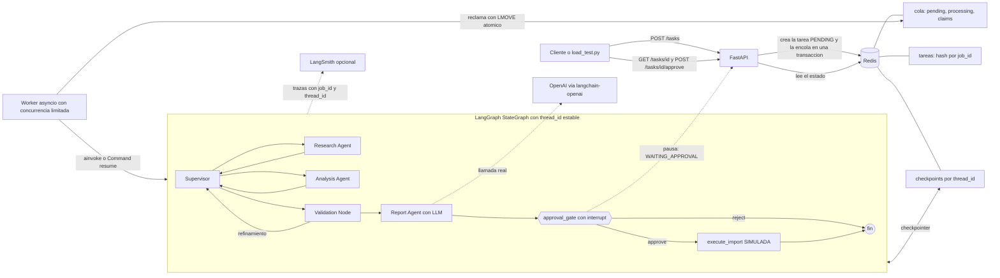

# L10n QA Orchestrator — Módulo 7

Entrega del Módulo 7. Partí del proyecto del Módulo 6 (el sistema multiagente que revisa archivos JSON localizados)
y le agregué una API con FastAPI, una cola con un worker, Redis para guardar el estado y los checkpoints,
observabilidad con LangSmith y una aprobación humana (Human-in-the-Loop) antes de una operación crítica.

> **Nota sobre qué probé y qué no.** Todo lo que dice «probado» lo ejecuté de verdad. La prueba de las cinco
> solicitudes concurrentes la corrí también con **OpenAI y LangSmith reales** (ver [Estado de verificación](#estado-de-verificación)).
> Dos limitaciones: el Monitor de LangSmith me mostró P50 y P99 (no P95), y el costo estimado por mi script quedó
> «desconocido» porque no configuré las tarifas.

## 1. Qué problema de L10n resuelve

Antes de importar archivos JSON traducidos a un CMS (Sitecore, Umbraco), el sistema compara cada traducción con su
archivo fuente y detecta **problemas estructurales y de compatibilidad con el CMS**:

- claves que faltan o sobran respecto del original;
- cambios en los tipos de datos;
- placeholders que faltan o fueron modificados;
- saltos de línea y caracteres de escape inconsistentes;
- JSON inválido u otras cosas que romperían la importación;
- excepciones de metadatos conocidas (`_gpiInternalData-toolName`, `_gpiInternalData-rootPath`).

**No hace QA lingüístico:** no corrige ni reescribe traducciones, y los archivos analizados no se modifican (los tests
comparan sus hashes SHA-256 antes y después).

## 2. Arquitectura



**Componentes (carpeta `app/`)**

| Archivo | Responsabilidad |
|---|---|
| `main.py` | API FastAPI (`POST /tasks`, `GET /tasks/{id}`, `POST /tasks/{id}/approve`, `GET /health`). No ejecuta el grafo. |
| `worker.py` | Consume la cola, ejecuta/reanuda el grafo, maneja errores, reintentos y recuperación de tareas huérfanas. |
| `queue.py` | Cola confiable en Redis (`pending` → `processing`, movimiento atómico con Lua). |
| `redis_store.py` | **Estado operativo** de las tareas con transiciones atómicas (compare-and-set en Lua). |
| `checkpointer.py` | **Checkpoints de LangGraph** en Redis (`BaseCheckpointSaver`), separado del estado operativo. |
| `graph.py` | `StateGraph` (Módulo 6 + nodos del Módulo 7). |
| `agents/` | `supervisor_agent`, `research_agent`, `analyst_agent`, `validation_agent` (Módulo 6) y `report_agent` (nuevo, usa el LLM). |
| `tools/` | `file_inspector`, `l10n_rules`, `structural_validator` (Módulo 6, sin cambios de lógica). |
| `hitl.py` | Puerta de aprobación (`interrupt`) y operación crítica simulada. |
| `llm/factory.py` | Fábrica de modelos desacoplada del proveedor. |
| `observability.py` | LangSmith opcional, correlación por tarea, tiempos por etapa, tokens, percentiles. |
| `config.py`, `schemas.py` | Configuración por variables de entorno; esquemas Pydantic y máquina de estados. |

### Qué reutilicé del Módulo 6

La carpeta `entrega 6` estaba disponible, así que reutilicé los agentes, las herramientas, las reglas, `state.py`,
`report.py`, los fixtures y los tests originales (ahora en `tests/`). Lo que cambié:

- Imports: `from state import …` pasó a `from app.state import …` (y lo mismo en el resto).
- `state.py`: agregué campos nuevos (`job_id`, `thread_id`, `stage_timings`, `resumen_llm`, `import_status`, `approval`…).
- `graph.py`: agregué `llm_report`, `approval_gate` y `execute_import` después de la validación. Antes el grafo
  terminaba en la validación, así que actualicé el test de topología.
- El CLI del Módulo 6 ahora está en `app/cli.py` y el demo en `scripts/demo_modulo6.py`. Borré el PNG viejo del grafo
  porque estaba desactualizado; el diagrama vigente es `docs/grafo.mmd`.

**El Módulo 6 no usaba ningún LLM.** Para tener llamadas reales al modelo sin perder la confiabilidad del QA, el LLM lo
uso solamente en `report_agent`: escribe un **resumen ejecutivo** a partir de hallazgos que *ya fueron validados*.
Los hallazgos siguen saliendo de las herramientas deterministas; el LLM no crea ni modifica hallazgos y no recibe el
contenido de los archivos ni las evidencias con texto traducido (solo id, severidad, categoría, archivo, ruta y mensaje).

## 3. Qué necesito para correrlo

- Python **3.12 o superior** (yo lo probé con 3.13).
- Un Redis común (no hace falta Redis Stack). Con Docker Compose se levanta solo.
- Opcional: una cuenta de OpenAI y otra de LangSmith.

## 4. Instalación local (sin Docker)

```bash
python -m venv .venv && source .venv/bin/activate        # en Windows: .venv\Scripts\activate
pip install -r requirements-dev.txt                       # solo para ejecutar: requirements.txt
cp .env.example .env                                      # y completarlo; con LLM_PROVIDER=local no hacen falta claves
redis-server --daemonize yes                              # o cualquier Redis accesible por REDIS_URL

# Opción A: API + worker en un solo proceso (cómodo para desarrollar)
EMBEDDED_WORKER=true uvicorn app.main:app --port 8000
# Opción B: dos procesos (como en producción)
uvicorn app.main:app --port 8000          # terminal 1
python -m app.worker                      # terminal 2
```

Swagger/OpenAPI: <http://localhost:8000/docs>. Las variables se leen del entorno, así que hay que cargar el `.env`
con la herramienta que prefieras (por ejemplo `export $(grep -v '^#' .env | xargs)`).

## 5. Docker Compose

```bash
cp .env.example .env        # completar lo necesario
docker compose up --build   # redis + api + worker
```

Redis tiene un volumen persistente (AOF), hay *healthchecks* y la API y el worker esperan a que Redis esté listo
(si tarda, reintentan y `/health` informa `degraded` mientras tanto). Los manifiestos de la importación simulada se
escriben en `./salida`.

> Ejecuté `docker-compose.yml` en mi PC (Windows con Docker Desktop) y la prueba de carga la corrí contra ese
> despliegue. Dos cosas que me hicieron perder tiempo: Docker Compose solo lee el archivo llamado **`.env`** (no
> `.env.example`), y los comentarios en la misma línea que un valor pueden terminar como parte del valor. Por eso el
> `.env` tiene que ir sin comentarios.

## 6. Configuración de OpenAI

```dotenv
LLM_PROVIDER=openai
OPENAI_API_KEY=sk-...          # nunca subirla al repositorio
OPENAI_MODEL=<un modelo de OpenAI que tengas disponible>
```

- `OPENAI_MODEL` es obligatorio y **no tiene valor por defecto**, para no dejar fijo un nombre que después quede viejo.
- Si falta la clave o el modelo, `POST /tasks` responde `503` con un mensaje claro y `/health` muestra
  `llm_configured: false`. **No se pasa a modo local en silencio.**
- `LLM_PROVIDER=local`: modo determinista **sin LLM** (no gasta tokens). El resumen sale de una plantilla y el
  resultado indica `llamada_real: false`; nunca simula una llamada.
- Costos: se pueden definir `OPENAI_PRICE_INPUT_PER_1M` y `OPENAI_PRICE_OUTPUT_PER_1M` (USD por millón de tokens, según
  la tarifa de tu cuenta) para obtener `costo.origen = "estimado_con_tarifa_configurada"`. Sin tarifas, el costo queda
  como `"desconocido"`. Los tokens vienen siempre de `usage_metadata`, que informa el proveedor.

### Proveedores

| Proveedor | Estado |
|---|---|
| `openai` | Implementado (`langchain-openai`) y **probado con llamadas reales** (modelo `gpt-4o-mini`): 5 de 5 tareas de la prueba de carga llamaron al modelo. |
| `local` | Implementado y probado (sin LLM). |
| Otros (Anthropic, Azure, etc.) | **No implementados.** |

Para agregar otro proveedor alcanza con implementar `ProveedorLLM` (`validar` y `crear`, devolviendo un `ManejadorLLM`)
y llamar a `registrar_proveedor(...)` en `app/llm/factory.py`; los agentes y el grafo no cambian. No hay *fallback*
automático entre proveedores ni dependencia de Anthropic (hay un test que lo verifica).

## 7. LangSmith (opcional)

```dotenv
LANGSMITH_TRACING=true
LANGSMITH_API_KEY=lsv2_...
LANGSMITH_PROJECT=l10n-qa-orchestrator
```

Se activa solo con `LANGSMITH_TRACING=true` **y** la clave puesta; si falta la clave la aplicación funciona igual, sin
trazas, y lo avisa en el log. `GET /health` muestra `langsmith_tracing`. Cada ejecución del grafo lleva la etiqueta
`job:<job_id>` y, en los metadatos, `job_id`, `thread_id`, proveedor, modelo e intento, así se puede filtrar en
LangSmith. Las trazas incluyen el estado de los nodos (hallazgos y metadatos de archivos); si no querés enviar eso,
podés usar `LANGSMITH_HIDE_INPUTS=true` / `LANGSMITH_HIDE_OUTPUTS=true`.

> Lo **verifiqué contra el dashboard real**: las trazas llegaron al proyecto `l10n-qa-orchestrator` (nodos,
> herramientas, llamada al modelo, tokens y costo). Las capturas están en [`screenshots/`](screenshots/).

## 8. API

Los ejemplos corresponden a los esquemas de `app/schemas.py`. Las rutas de `source_paths` / `target_paths` son
relativas a `INPUT_ROOT` (por defecto `./fixtures`); no se aceptan rutas fuera de esa carpeta.

### `POST /tasks` → `202 Accepted`

```bash
curl -s -X POST localhost:8000/tasks -H 'content-type: application/json' -d '{
  "request": "Compará los JSON de origen con sus traducciones y detectá problemas estructurales.",
  "source_paths": ["source/clean.en.json"],
  "target_paths": ["targets/clean.es.json"],
  "max_steps": 12,
  "require_approval": true }'
```
```json
{ "job_id": "90f017e05c6a41e5bbc0c406ab5d9de4",
  "thread_id": "thread-90f017e05c6a41e5bbc0c406ab5d9de4",
  "status": "PENDING",
  "status_url": "/tasks/90f017e05c6a41e5bbc0c406ab5d9de4",
  "enqueue_ms": 8.069 }
```
También devuelve el encabezado `Location`. Responde `422` si la solicitud es inválida (vacía, rutas que no existen o
que están fuera de `INPUT_ROOT`, `max_steps` fuera de 4–50) y `503` si falta configuración del LLM o Redis no responde.

### `GET /tasks/{job_id}`

Lee el estado **desde Redis**. `404` si no existe. Campos: `status`, `created_at`, `started_at`, `finished_at`,
`attempts`, `error`, `approval_request` (solo en `WAITING_APPROVAL`), `approval`, `result`, `metrics`.

```json
{ "job_id": "…", "status": "WAITING_APPROVAL", "attempts": 1,
  "approval_request": { "tipo": "aprobacion_importacion_cms",
                         "paquete": { "estado_qa": "PASS", "archivos": [ { "destino": "…/clean.es.json", "sha256_destino": "…" } ] } },
  "result": null, "metrics": { "queue_wait_s": 0.02, "execution_s": 0.09, "stages": [ { "agente": "Research Agent", "segundos": 0.0055 } ] } }
```

Cuando la tarea termina, `result` trae: `estado_general`, `resumen` (errores/advertencias/información), `hallazgos`
(cada uno con `severidad`, `archivo`, `ruta_json`, `mensaje`, `evidencia`), `agentes_y_etapas`,
`decisiones_supervisor`, `resumen_llm` (texto, proveedor, modelo, `llamada_real`, tokens, costo) e `importacion`.
`metrics` incluye `queue_wait_s`, `execution_s`, `total_s`, `stages[]` (duración por agente) y `attempts`.

### `POST /tasks/{job_id}/approve` → `202`

```bash
curl -s -X POST localhost:8000/tasks/$JOB/approve -H 'content-type: application/json' \
     -H "X-Approval-Token: $APPROVAL_TOKEN" \
     -d '{"decision":"approve","approver":"diego.farias","comment":"Revisado"}'    # o "reject"
```
```json
{ "job_id": "…", "status": "PENDING", "decision": "approve", "approver": "diego.farias",
  "decided_at": "2026-10-20T00:00:58+00:00", "message": "Aprobación registrada: la reanudación quedó encolada." }
```
- `409` si la tarea no está en `WAITING_APPROVAL` (ya se resolvió, sigue en curso, etc.) o si otra decisión llegó primero.
- `401` si `APPROVAL_TOKEN` está configurado y el encabezado `X-Approval-Token` falta o no coincide.
  Con `APP_ENV=production` y sin `APPROVAL_TOKEN`, el endpoint queda **cerrado** (`503`).
- La decisión queda guardada con fecha, decisión, aprobador y comentario.

### `GET /health`

```json
{ "status": "ok", "redis": true, "llm_provider": "local", "llm_configured": true,
  "langsmith_tracing": false, "queue_pending": 0, "version": "1.0.0" }
```
`status` pasa a `degraded` (HTTP 200) si Redis no responde. No expone credenciales ni URLs.

## 9. Estados de las tareas

`PENDING`, `RUNNING`, `WAITING_APPROVAL`, `DONE`, `FAILED`, `REJECTED`.

| Desde | Hacia | Cuándo |
|---|---|---|
| — | `PENDING` | `POST /tasks` (se crea y se encola en una sola transacción) |
| `PENDING` | `RUNNING` | un worker reclama el mensaje (compare-and-set atómico) |
| `RUNNING` | `WAITING_APPROVAL` | el grafo se frenó con `interrupt` (checkpoint guardado) |
| `WAITING_APPROVAL` | `PENDING` | `POST …/approve` registró la decisión y encoló la reanudación (`approve` **o** `reject`) |
| `RUNNING` | `DONE` | el grafo terminó (con la importación simulada ejecutada, no pedida o no elegible) |
| `RUNNING` | `REJECTED` | el grafo se reanudó con `reject`: la operación crítica **no** se ejecutó |
| `RUNNING` | `FAILED` | error no transitorio, o se agotaron los reintentos |
| `RUNNING` / `PENDING` | `PENDING` | reintento por una falla transitoria, o recuperación de una tarea huérfana |
| `PENDING` / `RUNNING` | `FAILED` | tarea interrumpida (worker caído) que superó `MAX_ATTEMPTS` |

Los estados finales (`DONE`, `FAILED`, `REJECTED`) no admiten más transiciones, y cualquier otra transición se rechaza.

## 10. Cola, worker y recuperación

- **Persistente:** la cola vive en Redis (`l10n:queue:*`); no uso `BackgroundTasks` ni memoria.
- **No bloquea el event loop:** los nodos del grafo son síncronos y LangGraph los corre en hilos al usar `ainvoke`.
- **Concurrencia:** `WORKER_CONCURRENCY` (un semáforo por worker); cada tarea tiene su propio `thread_id`.
- **Reclamo atómico:** `LMOVE pending → processing` (con Lua) y la confirmación (`LREM`) recién al terminar.
- **Latidos y reserva:** una tarea `RUNNING` renueva `lease_until`; si el worker se cae, la reserva vence
  (`LEASE_SECONDS`) y `recuperar_huerfanas` la reencola, o la marca `FAILED` si ya agotó `MAX_ATTEMPTS`.
  Un worker nuevo corre la recuperación al arrancar y después cada cierto tiempo.
- **Reintentos:** solo para fallas transitorias (red, Redis, límites de tasa del proveedor), con *backoff* y hasta
  `MAX_ATTEMPTS`. Los errores de lógica o de configuración van directo a `FAILED` con un mensaje sin credenciales.
- **Sin duplicar la operación crítica:** el reintento sigue **desde el checkpoint** y la importación simulada se crea
  con apertura exclusiva (`open(..., 'x')`); el paso a `RUNNING` y la aprobación son atómicos.
- La cola garantiza entrega *al menos una vez*; la idempotencia la dan el estado de la tarea y el checkpoint.

## 11. Redis y checkpoints

- **Estado operativo** (`redis_store.py`): un hash por tarea con estado, payload, resultado, error, aprobación y
  métricas, más un índice para la recuperación.
- **Checkpoints de LangGraph** (`checkpointer.py`): `RedisCheckpointSaver` implementa la interfaz pública
  `BaseCheckpointSaver` (síncrona y asíncrona). Guarda checkpoints, metadatos y escrituras pendientes (incluida la
  interrupción) por `thread_id` / `checkpoint_ns`.
- **Por qué no usé el `RedisSaver` oficial:** el paquete `langgraph-checkpoint-redis` necesita Redis Stack (RediSearch y
  RedisJSON), que no tenía disponible, y la consigna pide Redis estándar. Mi implementación es real y persistente (no
  hay diccionarios en memoria) y está testeada, pero **no es el paquete oficial**. Con Redis Stack se podría cambiar
  por `RedisSaver` en `FabricaGrafo` (eso no lo probé).

## 12. Human-in-the-Loop

La operación crítica es **preparar/autorizar el paquete de importación al CMS**, y es **simulada**: nunca se contacta a
Sitecore, Umbraco ni a otro sistema. «Ejecutarla» escribe un manifiesto en `salida/importaciones/<job_id>.json`.

1. El grafo analiza y valida. Si el QA da `PASS` o `NEEDS_REVIEW` y `require_approval` es `true`, `approval_gate` llama a
   `interrupt(...)`: **el grafo se frena de verdad** y el checkpoint queda en Redis. (Un `FAIL` o `INCOMPLETE` no es
   elegible: no se pide aprobación y el paquete queda bloqueado, con `import_status = NO_ELEGIBLE`.)
2. La tarea pasa a `WAITING_APPROVAL`; `GET /tasks/{id}` muestra qué se está pidiendo aprobar.
3. `POST /tasks/{id}/approve` registra la decisión y encola la reanudación.
4. El worker reanuda **el mismo `thread_id`** con `Command(resume=decision)`. Con `approve` corre `execute_import`; con
   `reject` el grafo termina y la tarea queda `REJECTED` sin ejecutar nada.
5. Una respuesta de aprobación inválida **nunca** cuenta como aprobación, y la operación crítica vuelve a revisar la
   aprobación y no se puede ejecutar dos veces.

Demo (con la API y el worker andando):

```bash
python scripts/demo_hitl.py --decision approve
python scripts/demo_hitl.py --decision reject
```

## 13. Tests

```bash
pip install -r requirements-dev.txt
pytest                      # unitarios + integración local (sin credenciales)
pytest -m openai_real       # SOLO con credenciales: llamadas reales a OpenAI (gasta tokens)
```

Los tests de Redis usan un **`redis-server` real y temporal** que levanta el propio `conftest.py` en un puerto libre
(hace falta tener el binario `redis-server`), o el Redis indicado en `REDIS_TEST_URL`. Si no hay ninguno, esos tests se
omiten y dicen el motivo. Los dobles de LLM (`tests/fakes.py`) están marcados como falsos y nunca se muestran como
llamadas a OpenAI.

| Archivo | Qué cubre |
|---|---|
| `test_api.py` | 202, GET, 404, validaciones 422, 503 por configuración, FAILED por excepción del worker, aprobación (404/409/401/503), `/health` (ok y degradado), OpenAPI |
| `test_redis_store.py` | persistencia y recuperación, transiciones atómicas y carreras, cola, aislamiento, checkpoints separados por hilo |
| `test_worker.py` | procesamiento, FAILED, reintentos acotados, recuperación de `RUNNING` huérfana, intentos agotados, duplicados, límite de concurrencia, aislamiento |
| `test_graph_resume.py` | ejecución completa, enrutamiento, límite de pasos, reanudación desde checkpoint, reanudación en «proceso nuevo» |
| `test_hitl.py` | interrupción real, aprobación, rechazo, respuestas inválidas, no elegible, idempotencia, reinicio |
| `test_llm_factory.py` | selección de OpenAI, configuración faltante, modo local determinista, proveedor nuevo, tokens/costos, sin Anthropic |
| `test_observability.py` | LangSmith con y sin credenciales, correlación por tarea, etapas, tokens, percentil |
| `test_end_to_end.py` | flujos completos aprobar/rechazar, doble aprobación simultánea, 5 solicitudes aisladas, reinicio de API + worker, traducciones intactas |
| Módulo 6 (`test_analyst_agent`, `test_research_agent`, `test_validation`, `test_graph_routing`, `test_modulo6_end_to_end`) | los tests originales, migrados |

## 14. Cómo reproducir la prueba de las 5 solicitudes concurrentes

Con la API y el worker andando (por ejemplo con `docker compose up --build`):

```bash
python scripts/load_test.py --base-url http://localhost:8000 --on-waiting approve --label local
```

El script manda **exactamente cinco** `POST /tasks` en paralelo (`httpx.AsyncClient` + `asyncio.gather`), anota el
código HTTP y la latencia de encolado de cada una y consulta cada tarea hasta que llega a un estado final. Si alguna
queda en `WAITING_APPROVAL`, la resuelve según `--on-waiting` (`approve`, `reject` o `report`, que solo la informa).
Después calcula el p95 (*nearest-rank*; con n = 5 es el máximo) y guarda JSON y CSV en `resultados/`. Termina con
código distinto de cero si alguna solicitud no fue aceptada o alguna tarea falló. Con `--label openai` y credenciales
válidas, el resumen también dice cuántas tareas hicieron llamadas reales al LLM.

Si usás Docker Desktop en Windows, necesitás `pip install httpx` en tu Python local para correr el script.

## 15. Dónde ver trazas, tokens, costos y latencias

- **Por tarea (siempre):** `GET /tasks/{id}` → `metrics` (cola, ejecución, total, etapas por agente) y
  `result.resumen_llm` (modelo, tokens, costo, `llamada_real`).
- **En la plataforma:** LangSmith, proyecto `l10n-qa-orchestrator`, filtrando por la etiqueta `job:<job_id>`.
- **Tipos de costo:** `informado por la plataforma` (lo que muestra LangSmith), `estimado_con_tarifa_configurada`
  (tokens × la tarifa del `.env`) o `desconocido`. No inventé precios.
- **Latencias que no hay que mezclar:** encolado (`POST /tasks`) ≠ duración total de la tarea ≠ tiempo de ejecución en
  el servidor ≠ p95 del conjunto.

## 16. Capturas de pantalla

Son capturas reales del dashboard de LangSmith, sacadas después de correr las cinco solicitudes concurrentes con
OpenAI. El detalle de cada una (y sus limitaciones) está en [`screenshots/README.md`](screenshots/README.md).

## Estado de verificación

| Elemento | Estado |
|---|---|
| API, cola, worker, estado en Redis, checkpoints, HITL, aislamiento, recuperación | **Probado localmente** contra un `redis-server` real |
| Tests | **199 pasaron** en un entorno virtual nuevo con `pip install -r requirements-dev.txt` (queda afuera 1 test `openai_real`, a propósito) |
| 5 solicitudes concurrentes, modo `local` | **Corridas con procesos reales** (API `uvicorn` + worker aparte): 5×`202`, 5 `DONE`. Resultados en `resultados/load_test_local_*.json/csv`. Encolado p95 = 22,6 ms; duración total p95 = 1,05 s (incluye el intervalo de sondeo de 0,5 s). **Son mediciones locales sin LLM, no métricas de un dashboard.** |
| 5 solicitudes concurrentes con **OpenAI real** (`gpt-4o-mini`) | **Corridas** con Docker Compose: 5×`202`, 5 `DONE`, **5 de 5 con llamadas reales al LLM, 2.889 tokens en total**. Encolado p95 = 57,1 ms; duración total p95 = 4,73 s (el máximo de 5 muestras); ejecución en el servidor p95 = 2,71 s. Resultados en `resultados/load_test_openai_20261020T012925Z.json/csv`. |
| LangSmith conectado y capturas | **Verificado**: trazas por tarea con nodos, herramientas, modelo, tokens y costo. Capturas en `screenshots/` (aparecen 11 trazas porque incluyen el demo y un intento fallido por falta de crédito; ver `screenshots/README.md`). |
| Costo por ejecución | **Informado por LangSmith** (por ejemplo $0,00010905 para una tarea de 436 tokens, visible en la vista de hilo). El **costo estimado por mi script quedó «desconocido»**: no configuré `OPENAI_PRICE_*`. |
| Latencia p95 en el dashboard | **Parcial**: el Monitor de LangSmith me mostró **P50 y P99**, no P95. El p95 de la corrida es el que calcula `scripts/load_test.py` (del lado del cliente, nearest-rank). |
| Docker Compose | **Lo corrí yo** (`docker compose up`): Redis, API y worker arrancaron, `/health` respondió y la prueba de carga corrió contra ese despliegue |
| Repositorio público de GitHub | **Publicado** (ver sección 19) |

## 17. Seguridad y credenciales

- Las claves se leen solo del entorno; `.env` está en `.gitignore` y `.env.example` no tiene secretos.
- `/health` y los errores no muestran claves ni URLs; los mensajes de error de las tareas se limpian (`sk-…`, `lsv2_…`, `Bearer …`).
- La API solo lee archivos dentro de `INPUT_ROOT` (protección contra *path traversal*) y `job_id` se valida antes de usarse en rutas.
- La aprobación se protege con `APPROVAL_TOKEN` (comparación en tiempo constante) y queda cerrada en producción si no está configurado.
- La imagen Docker usa un usuario sin privilegios.

## 18. Limitaciones

- El `RedisCheckpointSaver` es propio (sección 11); no probé el `RedisSaver` oficial con Redis Stack.
- Si un worker se da por muerto pero en realidad seguía vivo (por una pausa larga), podría terminar una tarea que otro
  worker ya retomó. Las transiciones atómicas y la creación exclusiva del manifiesto evitan duplicar la operación
  crítica, pero no implementé un *fencing token*.
- La cola es «al menos una vez» y no hay cola de mensajes muertos (las tareas agotadas pasan a `FAILED`).
- `POST /tasks` y `GET /tasks` no tienen autenticación; solo la aprobación usa token. Si se expone, habría que
  ponerla detrás de un proxy con autenticación.
- El LLM solo redacta el resumen; no participa en detectar hallazgos (fue una decisión a propósito, ver sección 2).
- La reanudación tras `WAITING_APPROVAL` suma al `execution_s` solo el tiempo activo.
- La importación al CMS es siempre simulada.

## 19. Repositorio en GitHub

El código está publicado en: <https://github.com/rexorelaxo-cloud/l10n-qa-orchestrator-entrega-7->

Para clonarlo y probarlo:

```bash
git clone https://github.com/rexorelaxo-cloud/l10n-qa-orchestrator-entrega-7-.git
cd l10n-qa-orchestrator-entrega-7-
```
