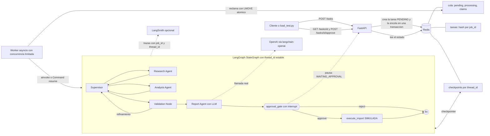

# L10n QA Orchestrator — Módulo 7

API REST + procesamiento asíncrono + Redis + observabilidad + aprobación humana (Human-in-the-Loop) sobre el
sistema multiagente del Módulo 6.

> **Estado honesto de la entrega.** Todo lo que figura como «probado» se ejecutó. La prueba de cinco solicitudes
> concurrentes se corrió también **con OpenAI y LangSmith reales** (ver [Estado de verificación](#estado-de-verificación)).
> Limitaciones: el Monitor de LangSmith mostró P50 y P99 (no P95), y el costo estimado por el script quedó
> «desconocido» porque no se configuraron tarifas.

## 1. Qué problema de L10n resuelve

Antes de importar archivos JSON localizados a un CMS (Sitecore, Umbraco), el sistema compara cada traducción con
su archivo fuente y detecta **problemas estructurales y de compatibilidad con el CMS**:

- claves ausentes o adicionales respecto del origen;
- diferencias de tipos de datos;
- placeholders faltantes o modificados;
- saltos de línea y caracteres de escape inconsistentes;
- JSON inválido u otras inconsistencias que romperían la importación;
- excepciones de metadatos conocidas (`_gpiInternalData-toolName`, `_gpiInternalData-rootPath`).

**No hace QA lingüístico:** nunca corrige ni reescribe traducciones. Los archivos analizados no se modifican
(las pruebas verifican sus hashes SHA-256 antes y después).

## 2. Arquitectura



**Componentes (carpeta `app/`)**

| Archivo | Responsabilidad |
|---|---|
| `main.py` | API FastAPI (`POST /tasks`, `GET /tasks/{id}`, `POST /tasks/{id}/approve`, `GET /health`). No ejecuta el grafo. |
| `worker.py` | Consume la cola, ejecuta/reanuda el grafo, maneja errores, reintentos y recuperación de tareas huérfanas. |
| `queue.py` | Cola confiable en Redis (`pending` → `processing`, movimiento atómico con Lua). |
| `redis_store.py` | **Estado operativo** de las tareas con transiciones atómicas (compare-and-set en Lua). |
| `checkpointer.py` | **Checkpoints de LangGraph** en Redis (`BaseCheckpointSaver`), separado del estado operativo. |
| `graph.py` | `StateGraph` (Módulo 6 + nodos del Módulo 7). |
| `agents/` | `supervisor_agent`, `research_agent`, `analyst_agent`, `validation_agent` (Módulo 6) y `report_agent` (nuevo, usa el LLM). |
| `tools/` | `file_inspector`, `l10n_rules`, `structural_validator` (Módulo 6, sin cambios de lógica). |
| `hitl.py` | Puerta de aprobación (`interrupt`) y operación crítica simulada. |
| `llm/factory.py` | Fábrica de modelos desacoplada del proveedor. |
| `observability.py` | LangSmith opcional, correlación por tarea, tiempos por etapa, tokens, percentiles. |
| `config.py`, `schemas.py` | Configuración por variables de entorno; esquemas Pydantic y máquina de estados. |

### Reutilización del Módulo 6

El proyecto del Módulo 6 (carpeta `entrega 6`) **estaba disponible y se reutilizó**: agentes, herramientas, reglas,
`state.py`, `report.py`, fixtures y las pruebas originales (ahora en `tests/`, con los imports migrados al
paquete `app`). Cambios sobre el código anterior:

- Imports: `from state import …` → `from app.state import …` (y equivalentes).
- `state.py`: se agregaron campos (`job_id`, `thread_id`, `stage_timings`, `resumen_llm`, `import_status`, `approval`…).
- `graph.py`: se agregaron `llm_report`, `approval_gate` y `execute_import` después de la validación; la
  validación ya no termina el grafo (la prueba de topología se actualizó en consecuencia).
- El CLI del Módulo 6 pasó a `app/cli.py` y el demo a `scripts/demo_modulo6.py`. El PNG del grafo del Módulo 6
  se eliminó por estar desactualizado; el diagrama vigente es `docs/grafo.mmd`.

**El Módulo 6 era 100 % determinista (no usaba ningún LLM).** Para que haya llamadas reales al modelo sin
comprometer la fiabilidad del QA, el LLM se usa únicamente en `report_agent`: redacta un **resumen ejecutivo**
a partir de los hallazgos *ya validados*. Los hallazgos siguen saliendo de las herramientas deterministas; el
LLM no crea ni modifica hallazgos, no recibe el contenido de los archivos ni las evidencias con textos
traducidos (solo id, severidad, categoría, archivo, ruta y mensaje).

## 3. Requisitos previos

- Python **3.12 o superior** (probado con 3.13).
- Un servidor **Redis** estándar (no hace falta Redis Stack). Con Docker Compose se levanta solo.
- Opcional: cuenta de OpenAI y de LangSmith.

## 4. Instalación local (sin Docker)

```bash
python -m venv .venv && source .venv/bin/activate        # en Windows: .venv\Scripts\activate
pip install -r requirements-dev.txt                       # solo ejecución: requirements.txt
cp .env.example .env                                      # y completar; LLM_PROVIDER=local no necesita claves
redis-server --daemonize yes                              # o cualquier Redis accesible por REDIS_URL

# Opción A: API + worker en un solo proceso (cómodo para desarrollo)
EMBEDDED_WORKER=true uvicorn app.main:app --port 8000
# Opción B: dos procesos (como en producción)
uvicorn app.main:app --port 8000          # terminal 1
python -m app.worker                      # terminal 2
```

Swagger/OpenAPI: <http://localhost:8000/docs>. Las variables se leen del entorno (`export $(grep -v '^#' .env | xargs)`
o cargue el `.env` con su herramienta preferida).

## 5. Docker Compose

```bash
cp .env.example .env        # completar lo necesario
docker compose up --build   # redis + api + worker
```

Incluye volumen persistente de Redis (AOF), *healthchecks* y `depends_on` con `service_healthy`. La API y el worker
toleran que Redis tarde en estar disponible (reintentos con *backoff*; `/health` informa `degraded` mientras tanto).
Los manifiestos de la importación simulada se escriben en `./salida`.
> `docker-compose.yml` se ejecutó en el equipo del autor (Windows con Docker Desktop) y la prueba de carga se corrió
> contra ese despliegue. Importante: Docker Compose solo lee el archivo llamado **`.env`** (no `.env.example`) y los
> comentarios en la misma línea de un valor pueden interpretarse como parte del valor: use un `.env` sin comentarios.

## 6. Configuración de OpenAI

```dotenv
LLM_PROVIDER=openai
OPENAI_API_KEY=sk-...          # nunca la suba al repositorio
OPENAI_MODEL=<modelo de OpenAI que tenga disponible>
```

- `OPENAI_MODEL` es obligatorio y **no hay un valor por defecto**, para no fijar un nombre que pueda quedar obsoleto.
- Si falta la clave o el modelo, `POST /tasks` responde `503` con un mensaje claro y `/health` muestra
  `llm_configured: false`. **No se cambia a modo local en silencio.**
- `LLM_PROVIDER=local`: modo determinista **sin LLM** (no consume tokens). El resumen se genera con una plantilla y
  el resultado indica `llamada_real: false`; nunca se simula una llamada.
- Costos: defina `OPENAI_PRICE_INPUT_PER_1M` y `OPENAI_PRICE_OUTPUT_PER_1M` (USD por millón de tokens, según la
  tarifa vigente de su cuenta) para obtener `costo.origen = "estimado_con_tarifa_configurada"`. Sin tarifas, el
  costo figura como `"desconocido"`. Los tokens provienen siempre de `usage_metadata` informado por el proveedor.

### Proveedores

| Proveedor | Estado |
|---|---|
| `openai` | Implementado (`langchain-openai`) y **probado con llamadas reales** (modelo `gpt-4o-mini`): 5 de 5 tareas de la prueba de carga hicieron llamadas reales. |
| `local` | Implementado y probado (sin LLM). |
| Otros (Anthropic, Azure, etc.) | **No implementados.** Extensión futura: ver abajo. |

Para agregar uno basta con implementar `ProveedorLLM` (`validar` y `crear`, devolviendo un `ManejadorLLM`) y llamar a
`registrar_proveedor(...)` en `app/llm/factory.py`; los agentes y el grafo no cambian. No hay *fallback* automático
entre proveedores ni dependencia de Anthropic (una prueba lo verifica).

## 7. LangSmith (opcional)

```dotenv
LANGSMITH_TRACING=true
LANGSMITH_API_KEY=lsv2_...
LANGSMITH_PROJECT=l10n-qa-orchestrator
```

Se activa solo con `LANGSMITH_TRACING=true` **y** clave presente; si falta la clave la aplicación sigue funcionando sin
trazas y lo informa en el log. `GET /health` muestra `langsmith_tracing`. Cada ejecución del grafo se etiqueta con
`job:<job_id>` y lleva `job_id`, `thread_id`, proveedor, modelo e intento en sus metadatos (se pueden filtrar en
LangSmith). Las trazas incluyen el estado de los nodos (hallazgos y metadatos de archivos); si no desea enviar esa
información, use `LANGSMITH_HIDE_INPUTS=true` / `LANGSMITH_HIDE_OUTPUTS=true` (variables de LangSmith).

> La integración se **verificó contra el dashboard real**: las trazas llegaron al proyecto `l10n-qa-orchestrator`
> (nodos, herramientas, llamada al modelo, tokens y costo). Ver [`screenshots/`](screenshots/).

## 8. API

Todos los ejemplos corresponden a los esquemas implementados (`app/schemas.py`). Las rutas de `source_paths` /
`target_paths` son relativas a `INPUT_ROOT` (por defecto `./fixtures`); no se aceptan rutas fuera de esa carpeta.

### `POST /tasks` → `202 Accepted`

```bash
curl -s -X POST localhost:8000/tasks -H 'content-type: application/json' -d '{
  "request": "Compará los JSON de origen con sus traducciones y detectá problemas estructurales.",
  "source_paths": ["source/clean.en.json"],
  "target_paths": ["targets/clean.es.json"],
  "max_steps": 12,
  "require_approval": true }'
```
```json
{ "job_id": "90f017e05c6a41e5bbc0c406ab5d9de4",
  "thread_id": "thread-90f017e05c6a41e5bbc0c406ab5d9de4",
  "status": "PENDING",
  "status_url": "/tasks/90f017e05c6a41e5bbc0c406ab5d9de4",
  "enqueue_ms": 8.069 }
```
También devuelve el encabezado `Location`. `422` ante solicitudes inválidas (vacías, rutas inexistentes o fuera de
`INPUT_ROOT`, `max_steps` fuera de 4–50); `503` si falta configuración del LLM o Redis no responde.

### `GET /tasks/{job_id}`

Lee el estado **desde Redis**. `404` si no existe. Campos: `status`, `created_at`, `started_at`, `finished_at`,
`attempts`, `error`, `approval_request` (solo en `WAITING_APPROVAL`), `approval`, `result`, `metrics`.

```json
{ "job_id": "…", "status": "WAITING_APPROVAL", "attempts": 1,
  "approval_request": { "tipo": "aprobacion_importacion_cms",
                         "paquete": { "estado_qa": "PASS", "archivos": [ { "destino": "…/clean.es.json", "sha256_destino": "…" } ] } },
  "result": null, "metrics": { "queue_wait_s": 0.02, "execution_s": 0.09, "stages": [ { "agente": "Research Agent", "segundos": 0.0055 } ] } }
```

Al terminar, `result` contiene: `estado_general`, `resumen` (errores/advertencias/información), `hallazgos` (cada uno con
`severidad`, `archivo`, `ruta_json`, `mensaje`, `evidencia`), `agentes_y_etapas`, `decisiones_supervisor`,
`resumen_llm` (texto, proveedor, modelo, `llamada_real`, tokens, costo) e `importacion`. `metrics` incluye
`queue_wait_s`, `execution_s`, `total_s`, `stages[]` (duración por agente) y `attempts`.

### `POST /tasks/{job_id}/approve` → `202`

```bash
curl -s -X POST localhost:8000/tasks/$JOB/approve -H 'content-type: application/json' \
     -H "X-Approval-Token: $APPROVAL_TOKEN" \
     -d '{"decision":"approve","approver":"diego.farias","comment":"Revisado"}'    # o "reject"
```
```json
{ "job_id": "…", "status": "PENDING", "decision": "approve", "approver": "diego.farias",
  "decided_at": "2026-10-20T00:00:58+00:00", "message": "Aprobación registrada: la reanudación quedó encolada." }
```
- `409` si la tarea no está en `WAITING_APPROVAL` (ya resuelta, aún en curso, etc.) o si otra decisión ganó la carrera.
- `401` si `APPROVAL_TOKEN` está configurado y falta/ no coincide el encabezado `X-Approval-Token`.
  Con `APP_ENV=production` y sin `APPROVAL_TOKEN`, el endpoint queda **cerrado** (`503`).
- La decisión queda registrada con fecha, decisión, aprobador y comentario.

### `GET /health`

```json
{ "status": "ok", "redis": true, "llm_provider": "local", "llm_configured": true,
  "langsmith_tracing": false, "queue_pending": 0, "version": "1.0.0" }
```
`status` es `degraded` (HTTP 200) si Redis no responde. No expone credenciales ni URLs.

## 9. Estados de las tareas

`PENDING`, `RUNNING`, `WAITING_APPROVAL`, `DONE`, `FAILED`, `REJECTED`.

| Desde | Hacia | Cuándo |
|---|---|---|
| — | `PENDING` | `POST /tasks` (creación + encolado en una transacción) |
| `PENDING` | `RUNNING` | un worker reclama el mensaje (compare-and-set atómico) |
| `RUNNING` | `WAITING_APPROVAL` | el grafo se interrumpió con `interrupt` (checkpoint guardado) |
| `WAITING_APPROVAL` | `PENDING` | `POST …/approve` registró la decisión y encoló la reanudación (`approve` **o** `reject`) |
| `RUNNING` | `DONE` | el grafo terminó (con la importación simulada ejecutada, no solicitada o no elegible) |
| `RUNNING` | `REJECTED` | el grafo se reanudó con `reject`: la operación crítica **no** se ejecutó |
| `RUNNING` | `FAILED` | error no transitorio, o reintentos agotados |
| `RUNNING` / `PENDING` | `PENDING` | reintento ante falla transitoria, o recuperación de una tarea huérfana |
| `PENDING` / `RUNNING` | `FAILED` | tarea interrumpida (worker caído) que superó `MAX_ATTEMPTS` |

Los estados finales (`DONE`, `FAILED`, `REJECTED`) no admiten más transiciones. Cualquier otra transición se rechaza.

## 10. Cola, worker y recuperación

- **Persistente:** la cola vive en Redis (`l10n:queue:*`); no se usa `BackgroundTasks` ni memoria.
- **No bloquea el event loop:** los nodos del grafo son síncronos y LangGraph los ejecuta en hilos al usar `ainvoke`.
- **Concurrencia:** `WORKER_CONCURRENCY` (semáforo por worker); cada tarea tiene su `thread_id`.
- **Reclamo atómico:** `LMOVE pending → processing` (Lua) y confirmación (`LREM`) solo al terminar.
- **Latidos y reserva:** una tarea `RUNNING` renueva `lease_until`; si el worker muere, la reserva vence
  (`LEASE_SECONDS`) y `recuperar_huerfanas` la reencola o la marca `FAILED` si agotó `MAX_ATTEMPTS`.
  Un worker nuevo ejecuta la recuperación al arrancar y luego periódicamente.
- **Reintentos:** solo para fallas transitorias (red, Redis, límites de tasa del proveedor), con *backoff* y máximo
  `MAX_ATTEMPTS`. Los errores de lógica o configuración pasan directo a `FAILED` con un mensaje sin credenciales.
- **Sin duplicar operaciones críticas:** el reintento continúa **desde el checkpoint** y la importación simulada se
  crea con apertura exclusiva (`open(..., 'x')`); el cambio a `RUNNING` y la aprobación son atómicos.
- Garantía de la cola: *al menos una vez*; la idempotencia la aportan el estado de la tarea y el checkpoint.

## 11. Redis y checkpoints

- **Estado operativo** (`redis_store.py`): un hash por tarea con estado, payload, resultado, error, aprobación y
  métricas, más un índice para la recuperación.
- **Checkpoints de LangGraph** (`checkpointer.py`): `RedisCheckpointSaver` implementa la interfaz pública
  `BaseCheckpointSaver` (síncrona y asíncrona). Guarda checkpoints, metadatos y escrituras pendientes (incluida la
  interrupción) por `thread_id`/`checkpoint_ns`.
- **Por qué no `RedisSaver` oficial:** el paquete `langgraph-checkpoint-redis` requiere Redis Stack (RediSearch y
  RedisJSON), que no estaba disponible en el entorno de desarrollo y no es un requisito de la consigna del Redis
  estándar. La implementación propia es real y persistente (no hay diccionarios en memoria) y está probada, pero
  **no es el paquete oficial**: si prefiere `RedisSaver`, puede sustituirlo en `FabricaGrafo` usando Redis Stack
  (no probado aquí).

## 12. Human-in-the-Loop

La operación crítica es la **preparación/autorización del paquete de importación al CMS**, **simulada**: nunca se
contacta a Sitecore, Umbraco ni a otro sistema. «Ejecutarla» escribe un manifiesto verificable en
`salida/importaciones/<job_id>.json`.

1. El grafo analiza y valida. Si el QA da `PASS` o `NEEDS_REVIEW` y `require_approval` es `true`, `approval_gate` llama
   a `interrupt(...)`: **el grafo se detiene realmente** y el checkpoint queda en Redis. (Un `FAIL` o `INCOMPLETE` no es
   elegible: no se pide aprobación y el paquete queda bloqueado, `import_status = NO_ELEGIBLE`.)
2. La tarea pasa a `WAITING_APPROVAL`; `GET /tasks/{id}` muestra qué se pide aprobar.
3. `POST /tasks/{id}/approve` registra la decisión y encola la reanudación.
4. El worker reanuda **el mismo `thread_id`** con `Command(resume=decision)`. Con `approve` corre `execute_import`;
   con `reject` el grafo termina y la tarea queda `REJECTED` sin ejecutar nada.
5. Una respuesta de aprobación inválida **nunca** cuenta como aprobación; la operación crítica además revalida la
   aprobación y no puede ejecutarse dos veces.

Demostración reproducible (API y worker en marcha):

```bash
python scripts/demo_hitl.py --decision approve
python scripts/demo_hitl.py --decision reject
```

## 13. Pruebas

```bash
pip install -r requirements-dev.txt
pytest                      # unitarias + integración local (sin credenciales)
pytest -m openai_real       # SOLO con credenciales: llamadas reales a OpenAI (consume tokens)
```

Las pruebas de Redis usan un **`redis-server` real y efímero** que el propio `conftest.py` levanta en un puerto libre
(necesita el binario `redis-server`), o el Redis indicado en `REDIS_TEST_URL`. Si no hay ninguno, esas pruebas se
omiten con el motivo a la vista. Los dobles de LLM (`tests/fakes.py`) están rotulados como falsos y nunca se presentan
como llamadas a OpenAI.

| Archivo | Cubre |
|---|---|
| `test_api.py` | 202, GET, 404, validaciones 422, 503 de configuración, FAILED por excepción del worker, aprobación (404/409/401/503), `/health` (ok y degradado), OpenAPI |
| `test_redis_store.py` | persistencia y recuperación, transiciones atómicas y carrera, cola, aislamiento, checkpoints separados por hilo |
| `test_worker.py` | procesamiento, FAILED, reintentos acotados, recuperación de `RUNNING` huérfana, intentos agotados, duplicados, límite de concurrencia, aislamiento |
| `test_graph_resume.py` | ejecución completa, enrutamiento, límite de pasos, reanudación desde checkpoint, reanudación en «proceso nuevo» |
| `test_hitl.py` | interrupción real, aprobación, rechazo, respuestas inválidas, no elegible, idempotencia, reinicio |
| `test_llm_factory.py` | selección de OpenAI, configuración faltante, modo local determinista, proveedor nuevo, tokens/costos, sin Anthropic |
| `test_observability.py` | LangSmith con/sin credenciales, correlación por tarea, etapas, tokens, percentil |
| `test_end_to_end.py` | flujos completos aprobar/rechazar, doble aprobación simultánea, 5 solicitudes aisladas, reinicio de API+worker, traducciones intactas |
| Módulo 6 (`test_analyst_agent`, `test_research_agent`, `test_validation`, `test_graph_routing`, `test_modulo6_end_to_end`) | pruebas originales, migradas |

## 14. Cinco solicitudes concurrentes

```bash
python scripts/load_test.py --base-url http://localhost:8000 --on-waiting approve --label local
```

Envía **exactamente cinco** `POST /tasks` en paralelo (`httpx.AsyncClient` + `asyncio.gather`), registra código HTTP y
latencia de encolado, consulta cada tarea hasta su estado final, **resuelve `WAITING_APPROVAL`** según `--on-waiting`
(`approve`, `reject` o `report`, que la informa sin quedar sondeando), calcula el p95 (*nearest-rank*; con n = 5 es el
máximo) y exporta JSON y CSV en `resultados/`. Termina con código distinto de cero si alguna solicitud no se aceptó o
alguna tarea falló. Con `--label openai` y credenciales válidas confirma en su resumen cuántas tareas hicieron llamadas
reales al LLM.

## 15. Observar trazas, tokens, costos y latencias

- **Por tarea (siempre disponible):** `GET /tasks/{id}` → `metrics` (cola, ejecución, total, etapas por agente) y
  `result.resumen_llm` (modelo, tokens, costo, `llamada_real`).
- **Plataforma:** en LangSmith, proyecto `l10n-qa-orchestrator`, filtrando por la etiqueta `job:<job_id>`.
- **Tipos de costo:** `informado por la plataforma` (lo que muestre LangSmith), `estimado_con_tarifa_configurada`
  (tokens × tarifa de su `.env`) o `desconocido`. Nunca se inventan precios.
- **Latencias separadas:** latencia de encolado (`POST /tasks`) ≠ duración total de la tarea ≠ tiempo de ejecución en el
  servidor ≠ p95 del conjunto.

## 16. Capturas de pantalla

Capturas reales del dashboard de LangSmith, obtenidas con la prueba de las cinco solicitudes concurrentes en
modo OpenAI. Detalle de cada una (y de sus limitaciones) en [`screenshots/README.md`](screenshots/README.md).

## Estado de verificación

| Elemento | Estado |
|---|---|
| API, cola, worker, estado en Redis, checkpoints, HITL, aislamiento, recuperación | **Probado localmente** contra un `redis-server` real |
| Suite de pruebas | **199 pasadas** en un entorno virtual nuevo con `pip install -r requirements-dev.txt` (1 prueba `openai_real` excluida por diseño) |
| 5 solicitudes concurrentes, modo `local` | **Ejecutadas con procesos reales** (API `uvicorn` + worker aparte): 5×`202`, 5 `DONE`. Resultados en `resultados/load_test_local_*.json/csv`. Latencia de encolado p95 = 22,6 ms; duración total p95 = 1,05 s (incluye el intervalo de sondeo de 0,5 s). **Son mediciones locales sin LLM; no son métricas de un dashboard.** |
| 5 solicitudes concurrentes con **OpenAI real** (`gpt-4o-mini`) | **Ejecutadas** con Docker Compose: 5×`202`, 5 `DONE`, **5 de 5 con llamadas reales al LLM, 2.889 tokens en total**. Latencia de encolado p95 = 57,1 ms; duración total p95 = 4,73 s (máximo de 5 muestras); ejecución en servidor p95 = 2,71 s. Resultados en `resultados/load_test_openai_20261020T012925Z.json/csv`. |
| LangSmith conectado y capturas | **Verificado**: trazas por tarea con nodos, herramientas, modelo, tokens y costo. Capturas en `screenshots/`. |
| Costo por ejecución | **Informado por LangSmith** (p. ej. $0,00010905 para una tarea de 436 tokens, visible en la vista de hilo). El **costo estimado del script quedó «desconocido»**: no se configuraron `OPENAI_PRICE_*`. |
| Latencia p95 en el dashboard | **Parcial**: el Monitor de LangSmith mostró **P50 y P99**, no P95. El p95 de la corrida es el calculado por `scripts/load_test.py` (cliente), método nearest-rank. |
| Docker Compose | **Ejecutado por el autor del proyecto** (`docker compose up`): Redis, API y worker arrancaron, `/health` respondió y la prueba de carga corrió contra ese despliegue |
| Repositorio público de GitHub | **Pendiente**: no se publicó (ver más abajo) |

## 17. Seguridad y credenciales

- Las claves se leen únicamente del entorno; `.env` está en `.gitignore`; `.env.example` no contiene secretos.
- `/health` y los errores no exponen claves ni URLs; los mensajes de error de las tareas se sanean (`sk-…`, `lsv2_…`, `Bearer …`).
- La API solo lee archivos dentro de `INPUT_ROOT` (protección contra *path traversal*); `job_id` se valida antes de usarse en rutas.
- Aprobación protegida con `APPROVAL_TOKEN` (comparación en tiempo constante); cerrada en producción si no está configurado.
- Imagen Docker con usuario sin privilegios.

## 18. Limitaciones conocidas

- El `RedisCheckpointSaver` es propio (ver sección 11); no se probó el `RedisSaver` oficial con Redis Stack.
- Un worker declarado muerto que en realidad seguía vivo (pausa larga) podría terminar una tarea que otro worker ya
  retomó; las transiciones atómicas y la creación exclusiva del manifiesto evitan duplicar la operación crítica, pero no
  se implementó un *fencing token*.
- La cola es «al menos una vez»; no hay cola de mensajes muertos (las tareas agotadas pasan a `FAILED`).
- Sin autenticación en `POST /tasks` ni `GET /tasks`; solo la aprobación usa token. Colocar la API detrás de un proxy
  autenticado si se expone.
- El LLM solo redacta un resumen; no participa en la detección de hallazgos (decisión deliberada, ver sección 2).
- Los tiempos por etapa son de reloj; la reanudación tras `WAITING_APPROVAL` suma al `execution_s` solo el tiempo activo.
- La importación al CMS es siempre simulada.

## 19. Publicación en GitHub

No se publicó el repositorio (no hay acceso autorizado a GitHub desde este entorno). Pasos para hacerlo:

```bash
cd l10n-qa-orchestrator
git init && git add . && git status        # verificar que NO aparezca .env
git commit -m "L10n QA Orchestrator - Módulo 7"
gh repo create l10n-qa-orchestrator --public --source=. --push
```
